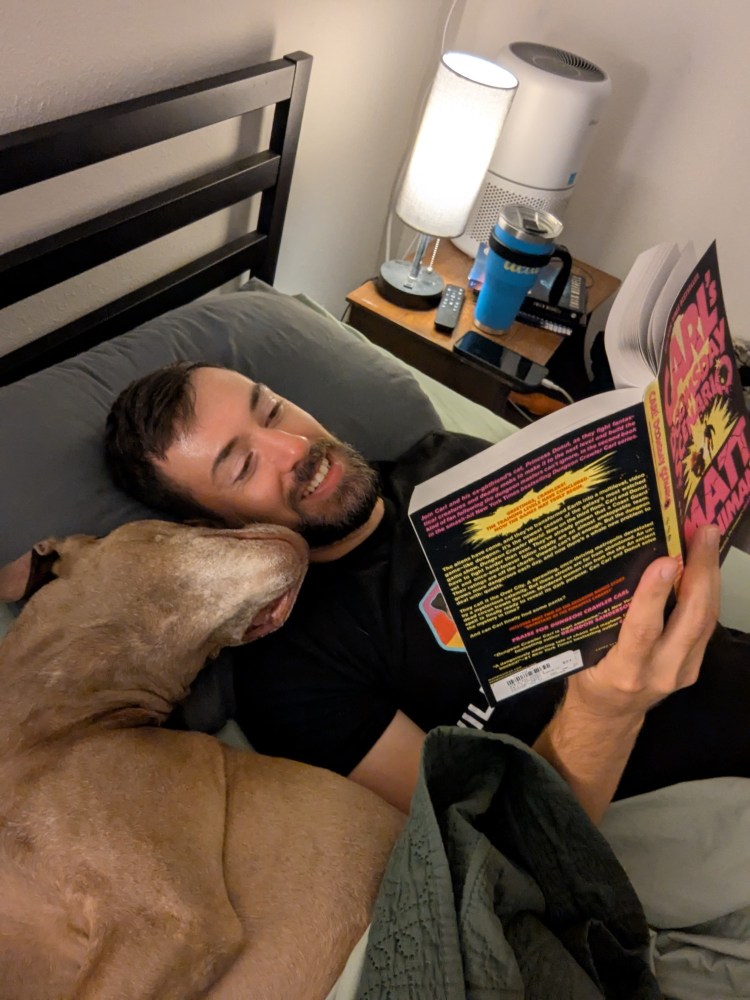

I feel like most years, I give myself a New Years resolution of finishing one book per month. Some years I struggle to meet that goal, whereas
some years, I read way more than that. This year I feel like I've been reading quite a lot. Right now I'm reading book 4 of the Dungeon Crawler
Carl series. I don't want to get into spoilers, but it's a fun book. You know how sometimes you hear so much hype around a piece of media that 
when you finally get around to enjoying it, there's no way for it to live up to the expectations? There's almost a part of you that wants it to 
be bad. Well, fortunately or unfortunately this series is just as fun and enjoyable as everyone has hyped it up to be.

Before I jumped into this series, I read 'Kill The Beast' by Serra Swift, which was another really fun and enjoyable little romantasy book.
If you're looking for something light and easy, I highly recommend it. It makes for a nice weekend read.

Anyways, that's all I really have to say about that for the moment. Reading is fun, and we should all do it more.
